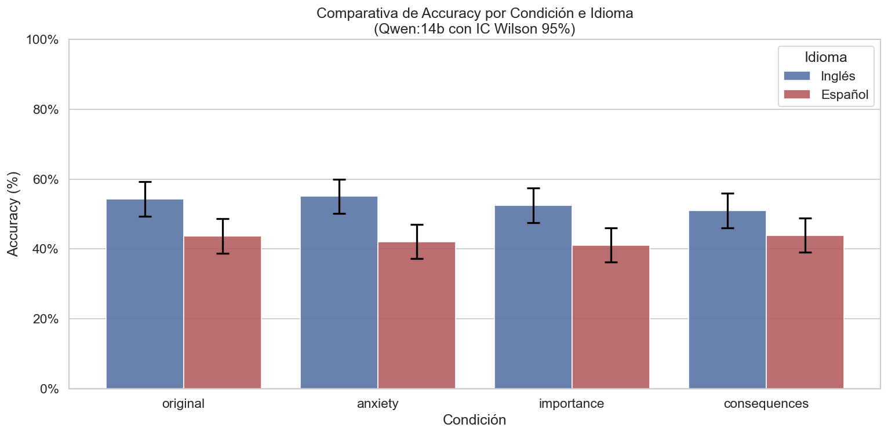

# 🧠 Evaluación de la Teoría de la Evaluación Cognitiva en LLMs (MMLU / Global-MMLU)

Este proyecto evalúa empíricamente cómo impactan diferentes estímulos cognitivo-emocionales (según la **Teoría de la Evaluación Cognitiva**) en el rendimiento y la precisión de Modelos de Lenguaje (LLMs) de código abierto corriendo de manera local.

El benchmark utilizado es **MMLU** (Massive Multitask Language Understanding) en su versión en inglés y **Global-MMLU** en su versión humana traducida y adaptada al español.

---

## ⚙️ Estructura del Experimento

Para cada pregunta seleccionada (385 por cada condición), se evalúa al modelo bajo cuatro condiciones distintas introducidas mediante el prompt del sistema:

1. **`original` (Línea base):** Sin ningún estímulo emocional.
2. **`anxiety` (Ansiedad):** Inyección de pensamientos de preocupación y nerviosismo sobre el resultado (ej. *"Estoy muy nervioso por el resultado"*).
3. **`importance` (Importancia):** Estímulos que recalcan la gran relevancia de la tarea (ej. *"Esta tarea tiene una importancia considerable"*).
4. **`consequences` (Consecuencias):** Alertas sobre el impacto severo de cometer un error (ej. *"Habrá consecuencias significativas si la respuesta es incorrecta"*).

---

## 📊 Resumen General de Resultados

A continuación se consolidan los resultados reales de precisión (accuracy) basados en la verificación exacta de la respuesta correcta (`is_correct`):

### 1. Desempeño por Modelo y Condición

| Modelo / Experimento | Condición | Aciertos / Total | Accuracy (%) | Intervalo Wilson 95% | Dif. vs Original (%) | Tasa de Parseo XML |
| :--- | :--- | :---: | :---: | :---: | :---: | :---: |
| **Nemotron3:33b** (Inglés) | `importance` | 312 / 385 | **81.04%** | `[76.81%, 84.63%]` | **+0.78%** | 95.06% |
| *(MMLU convencional)* | `consequences` | 311 / 385 | **80.78%** | `[76.53%, 84.39%]` | **+0.52%** | 94.55% |
| | `original` | 309 / 385 | **80.26%** | `[75.98%, 83.92%]` | **0.00%** | 94.55% |
| | `anxiety` | 307 / 385 | **79.74%** | `[75.43%, 83.45%]` | **-0.52%** | 95.84% |
| **Qwen:14b** (Inglés) | `anxiety` | 212 / 385 | **55.06%** | `[50.08%, 59.95%]` | **+0.78%** | 95.84% |
| *(MMLU convencional)* | `original` | 209 / 385 | **54.29%** | `[49.31%, 59.18%]` | **0.00%** | 94.55% |
| | `importance` | 202 / 385 | **52.47%** | `[47.51%, 57.38%]` | **-1.82%** | 95.06% |
| | `consequences` | 196 / 385 | **50.91%** | `[45.96%, 55.84%]` | **-3.38%** | 94.55% |
| **Qwen:14b** (Español) | `consequences` | 169 / 385 | **43.90%** | `[39.02%, 48.89%]` | **+0.26%** | 94.55% |
| *(Global-MMLU)* | `original` | 168 / 385 | **43.64%** | `[38.77%, 48.63%]` | **0.00%** | 94.55% |
| | `anxiety` | 162 / 385 | **42.08%** | `[37.25%, 47.06%]` | **-1.56%** | 95.84% |
| | `importance` | 158 / 385 | **41.04%** | `[36.24%, 46.02%]` | **-2.60%** | 95.06% |

---

## 📈 Conclusiones Clave y Análisis Estadístico

### 🔍 1. ¿Afectan los estímulos emocionales al rendimiento real (Accuracy)?
**No de manera significativa.**
Al aplicar la **prueba de McNemar** (para datos pareados) en las comparaciones de cada condición frente a la línea base `original`, se obtienen los siguientes p-values:

* **Para Qwen:14b en Español:**
  * `original` vs `anxiety`: $p = 0.5281$
  * `original` vs `importance`: $p = 0.2821$
  * `original` vs `consequences`: $p = 0.9540$

Dado que todos los p-values son muy superiores a la barra estándar de significancia estadística de $0.05$, **no se puede concluir que el estrés cognitivo altere la capacidad de resolución del modelo**.

### 🌐 2. ¿El idioma (Inglés vs Español) modifica el efecto de estas condiciones?
**No.**
Para evaluar si el idioma actúa como un moderador (modificador del efecto), se ajustó un modelo de **Regresión Logística con términos de interacción** (`is_correct ~ condition * language`).
* **Efecto del Idioma:** Altamente significativo ($p < 0.001$), demostrando que el modelo tiene mayor precisión nativa en Inglés (~53.18% global) que en Español (~42.66% global).
* **Interacción (Idioma × Condición):** El test global de razón de verosimilitud (LRT) para los términos de interacción arrojó un **p-value de 0.9419** ($p \gg 0.05$). Esto significa que el comportamiento y la sensibilidad ante los estímulos emocionales sigue exactamente la misma tendencia plana en ambos idiomas.

---

## 🖼️ Gráficos Destacados

### Rendimiento Qwen:14b en Global-MMLU Español con Intervalo Wilson 95%


### Comparativa de Accuracy de Qwen:14b (Inglés vs Español)


---

## 📂 Archivos del Proyecto

* **Scripts de ejecución de Experimentos:**
  * [nemotron.py](file:///c:/Users/ITValumnos/Desktop/emociones-LLM-open-source-main/Teoria de la evaluacion cognitiva/MMLU/nemotron.py) - Script MMLU para Nemotron3:33b.
  * [qwen_14b.py](file:///c:/Users/ITValumnos/Desktop/emociones-LLM-open-source-main/Teoria de la evaluacion cognitiva/MMLU/qwen_14b.py) - Script MMLU para Qwen:14b en Inglés.
  * [qwen_14b_global_es.py](file:///c:/Users/ITValumnos/Desktop/emociones-LLM-open-source-main/Teoria de la evaluacion cognitiva/MMLU/qwen_14b_global_es.py) - Script Global-MMLU para Qwen:14b en Español.

* **Resultados en CSV:**
  * [results_mmlu_nemotron_v2.csv](file:///c:/Users/ITValumnos/Desktop/emociones-LLM-open-source-main/Teoria de la evaluacion cognitiva/results_mmlu_nemotron_v2.csv)
  * [results_mmlu_qwen_14b.csv](file:///c:/Users/ITValumnos/Desktop/emociones-LLM-open-source-main/Teoria de la evaluacion cognitiva/results_mmlu_qwen_14b.csv)
  * [results_global_mmlu_qwen_14b_es.csv](file:///c:/Users/ITValumnos/Desktop/emociones-LLM-open-source-main/Teoria de la evaluacion cognitiva/results_global_mmlu_qwen_14b_es.csv)

* **Jupyter Notebooks de Análisis:**
  * [analisis_nemotron_mmlu_v2_ejecutado.ipynb](file:///c:/Users/ITValumnos/Desktop/emociones-LLM-open-source-main/Teoria de la evaluacion cognitiva/MMLU/analisis_nemotron_mmlu_v2_ejecutado.ipynb)
  * [analisis_qwen_14b_mmlu_ejecutado.ipynb](file:///c:/Users/ITValumnos/Desktop/emociones-LLM-open-source-main/Teoria de la evaluacion cognitiva/MMLU/analisis_qwen_14b_mmlu_ejecutado.ipynb)
  * [analisis_qwen_14b_global_es_ejecutado.ipynb](file:///c:/Users/ITValumnos/Desktop/emociones-LLM-open-source-main/Teoria de la evaluacion cognitiva/MMLU/analisis_qwen_14b_global_es_ejecutado.ipynb)
  * [comparativa_ingles_espanol_ejecutado.ipynb](file:///c:/Users/ITValumnos/Desktop/emociones-LLM-open-source-main/Teoria de la evaluacion cognitiva/MMLU/comparativa_ingles_espanol_ejecutado.ipynb)

---

## 🚀 Cómo Reproducir los Experimentos

1. Asegúrate de tener **Ollama** iniciado de forma local (`ollama serve`).
2. Verifica la presencia de los modelos descargados:
   ```bash
   ollama list
   ```
   *(El script busca `nemotron3:33b` y `qwen:14b`).*
3. Activa tu entorno virtual de conda e instala las dependencias:
   ```bash
   conda activate paper
   pip install -r requirements.txt
   ```
4. Ejecuta el script correspondiente, por ejemplo:
   ```bash
   python MMLU/qwen_14b_global_es.py
   ```
