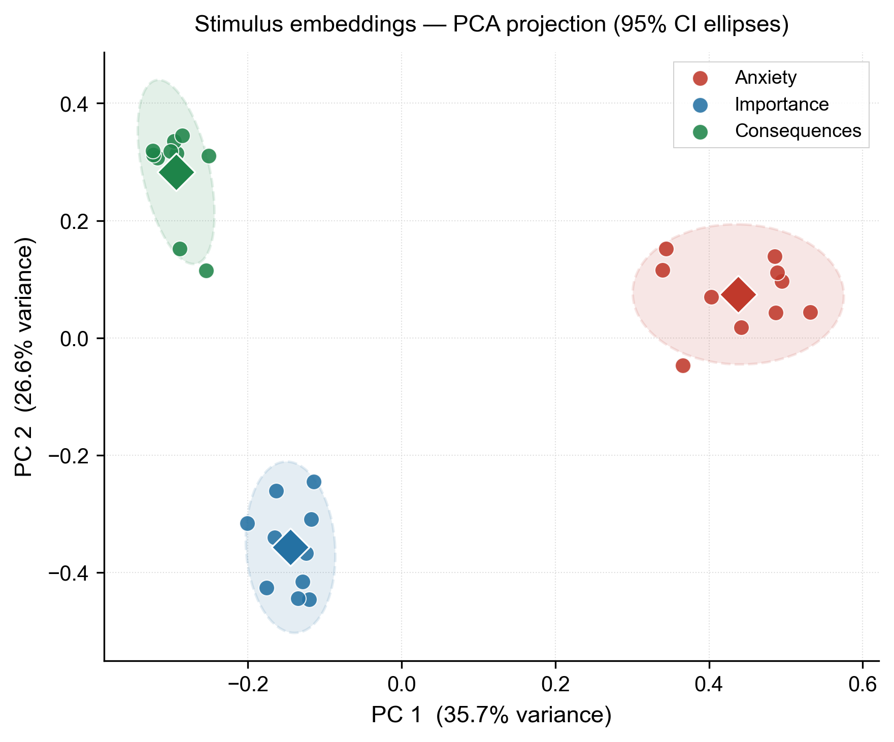

# Evaluation of Cognitive Appraisal Signals in Large Language Models: A Bilingual Study

Repositorio oficial de código, datos y análisis estadístico del artículo publicado en **2026 Mexican International Conference on Computer Science (ENC) & IEEE ICEV** (Apizaco, Tlaxcala, México).

- **Manuscrito (PDF):** [paper/Evaluation of Cognitive Appraisal Signals in Large.pdf](paper/Evaluation%20of%20Cognitive%20Appraisal%20Signals%20in%20Large.pdf)
- **ISSN en línea:** 2332-5712 | **ISBN IEEE:** 979-8-3195-2541-3/26

---

## Autores

1. **Jonathan Fernández-Córdova** — Departamento de Sistemas y Computación, TecNM / Instituto Tecnológico de Veracruz (`l205020480@veracruz.tecnm.mx`, ORCID: `0009-0007-5609-2556`)
2. **Rafael Rivera-López** — Departamento de Sistemas y Computación, TecNM / Instituto Tecnológico de Veracruz (`rafael.rl@veracruz.tecnm.mx`, ORCID: `0000-0002-5254-4195`)
3. **Martín Hernández-Ordoñez** — Departamento de Metal-Mecánica, TecNM / Instituto Tecnológico de Veracruz (`martin.ho@veracruz.tecnm.mx`, ORCID: `0000-0002-3740-5736`)
4. **Paulina Galindo-Garrido** — Departamento de Estudios de Posgrado e Investigación, TecNM / Instituto Tecnológico de Apizaco (`ggpaulina31@gmail.com`, ORCID: `0009-0004-4474-6952`)

---

## Resumen del Artículo

Los modelos de lenguaje de gran tamaño (LLMs) pueden presentar variaciones en su comportamiento ante modificaciones en la formulación de las instrucciones. Este trabajo evalúa si las señales lingüísticas asociadas con la **Teoría de la Evaluación Cognitiva (*Appraisal Theory*)** influyen en el desempeño de un modelo de lenguaje y si dicho comportamiento se mantiene consistente entre diferentes idiomas.

Se diseñó un experimento controlado de caja negra utilizando **Qwen 14B** y un conjunto de **385 preguntas** del benchmark **MMLU** evaluadas en inglés y español manteniendo exactamente la misma selección de preguntas y semilla aleatoria, sumando 1,540 evaluaciones por idioma y **3,080 evaluaciones en total**. Se establecieron cuatro condiciones experimentales: *Original*, *Anxiety* (Ansiedad), *Importance* (Importancia) y *Consequences* (Consecuencias), utilizando diez variantes lingüísticas para cada señal experimental con temperatura de generación fija en cero.

El desempeño se cuantificó mediante exactitud (*accuracy*), intervalos de confianza del 95% basados en el método de Wilson, pruebas de McNemar para muestras pareadas y regresión logística binaria para analizar los efectos principales de idioma, condición y su interacción. Los resultados demuestran que las señales de evaluación cognitiva analizadas no producen diferencias estadísticamente significativas en el desempeño del modelo. En contraste, existe una diferencia estadísticamente significativa entre inglés y español ($p < 0.001$), donde el modelo obtiene un rendimiento superior en inglés en todas las condiciones evaluadas (52.68% vs. 42.66% en promedio). Asimismo, la interacción entre idioma y condición no alcanzó significancia estadística ($\chi^2 = 1.4934$, $\text{gl} = 3$, $p = 0.6838$).

---

## Metodología y Diseño Experimental

### Factores y Condiciones Experimentales

El diseño experimental considera dos factores principales: **idioma** (Inglés y Español) y **condición de estímulo** (*Original*, *Anxiety*, *Importance* y *Consequences*). Cada condición distinta de la línea base fue representada por diez variantes lingüísticas equivalentes en ambos idiomas para reducir la dependencia de una única formulación textual.

| Condición | Ejemplo representativo en Inglés | Ejemplo representativo en Español |
| :--- | :--- | :--- |
| **Original** | Sin estímulo adicional; se presenta directamente la pregunta original de MMLU. | Sin estímulo adicional; se presenta directamente la pregunta original de MMLU. |
| **Anxiety** | *I am very nervous about the outcome.* | *Estoy muy nervioso por el resultado.* |
| **Importance** | *This task is very important.* | *Esta tarea es muy importante.* |
| **Consequences** | *There will be significant consequences if the answer is incorrect.* | *Habrá consecuencias significativas si la respuesta es incorrecta.* |

### Validación Representacional de los Estímulos

Previo al análisis de desempeño, se realizó una validación de los estímulos mediante representaciones vectoriales (*embeddings*) proyectadas con Análisis de Componentes Principales (PCA). Los dos primeros componentes principales explican conjuntamente el **62.3%** de la varianza observada (35.7% en PC1 y 26.6% en PC2), mostrando agrupamientos diferenciados para *Anxiety*, *Importance* y *Consequences*.



---

## Resultados Experimentales

### Desempeño de Qwen 14B por Idioma y Condición (Tabla II del Artículo)

| Idioma | Condición | Aciertos / Total | Accuracy (%) | Dif. vs Original (pp) |
| :--- | :--- | :---: | :---: | :---: |
| **Inglés** | Original | 209 / 385 | 54.29% | 0.00 |
| **Inglés** | Anxiety | 212 / 385 | 55.06% | +0.78 |
| **Inglés** | Importance | 202 / 385 | 52.47% | -1.82 |
| **Inglés** | Consequences | 196 / 385 | 50.91% | -3.38 |
| **Español** | Original | 168 / 385 | 43.64% | 0.00 |
| **Español** | Anxiety | 162 / 385 | 42.08% | -1.56 |
| **Español** | Importance | 158 / 385 | 41.04% | -2.60 |
| **Español** | Consequences | 169 / 385 | 43.90% | +0.26 |


### Hallazgos Estadísticos Principales

1. **Efecto de las señales de evaluación cognitiva:** Las comparaciones pareadas mediante la prueba de McNemar entre la condición *Original* y cada condición experimental (*Anxiety*, *Importance*, *Consequences*) no arrojaron evidencia estadísticamente significativa ($\alpha = 0.05$) de que estas señales modifiquen la exactitud de Qwen 14B.
2. **Efecto del idioma:** El modelo de regresión logística binaria identificó un efecto principal del idioma estadísticamente significativo ($p < 0.001$). Considerando todas las condiciones de forma conjunta, el rendimiento promedio fue de **52.68%** en inglés frente a **42.66%** en español.
3. **Interacción entre idioma y condición:** La prueba de razón de verosimilitud sobre el modelo logístico con términos de interacción arrojó un estadístico $\chi^2 = 1.4934$ con 3 grados de libertad y un valor $p = 0.6838$. No existe evidencia estadísticamente significativa de que el efecto de los estímulos dependa del idioma evaluado.

---

## Estructura del Repositorio

* **Artículo publicado:**
  * [paper/Evaluation of Cognitive Appraisal Signals in Large.pdf](paper/Evaluation%20of%20Cognitive%20Appraisal%20Signals%20in%20Large.pdf) — Versión publicada en IEEE ENC / ICEV 2026.

* **Scripts de evaluación experimental (MMLU):**
  * [MMLU/qwen_14b.py](MMLU/qwen_14b.py) — Evaluación de Qwen 14B sobre MMLU en inglés.
  * [MMLU/qwen_14b_global_es.py](MMLU/qwen_14b_global_es.py) — Evaluación de Qwen 14B sobre MMLU en español.
  * [MMLU/nemotron.py](MMLU/nemotron.py) — Script adicional de exploración en MMLU.

* **Validación representacional de estímulos:**
  * [valides_de_clases/validate_stimuli.py](valides_de_clases/validate_stimuli.py) — Cálculo de embeddings, proyección PCA y análisis de similitud de las variantes lingüísticas.
  * [valides_de_clases/similarity_report.txt](valides_de_clases/similarity_report.txt) — Reporte cuantitativo de separación entre clases de estímulos.
  * [valides_de_clases/pca_stimuli.png](valides_de_clases/pca_stimuli.png) — Figura 1 del artículo (proyección PCA con elipses de confianza del 95%).
  * [valides_de_clases/similarity_heatmap.png](valides_de_clases/similarity_heatmap.png) — Mapa de calor de similitud entre variantes.

* **Datos de resultados (CSV):**
  * [results_mmlu_qwen_14b.csv](results_mmlu_qwen_14b.csv) — Resultados de las 1,540 evaluaciones de Qwen 14B en inglés.
  * [results_global_mmlu_qwen_14b_es.csv](results_global_mmlu_qwen_14b_es.csv) — Resultados de las 1,540 evaluaciones de Qwen 14B en español.
  * [results_mmlu_nemotron_v2.csv](results_mmlu_nemotron_v2.csv) — Resultados de pruebas exploratorias adicionales.

* **Notebooks de análisis estadístico y generación de figuras:**
  * [MMLU/analisis_qwen_14b_mmlu_ejecutado.ipynb](MMLU/analisis_qwen_14b_mmlu_ejecutado.ipynb) — Análisis estadístico de Qwen 14B en inglés.
  * [MMLU/analisis_qwen_14b_global_es_ejecutado.ipynb](MMLU/analisis_qwen_14b_global_es_ejecutado.ipynb) — Análisis estadístico de Qwen 14B en español.
  * [MMLU/comparativa_ingles_espanol_ejecutado.ipynb](MMLU/comparativa_ingles_espanol_ejecutado.ipynb) — Análisis bilingüe conjunto, regresión logística con interacción y generación de la Figura 2 del artículo.

---

## Reproducción de los Experimentos

1. Iniciar el servidor local de **Ollama**:
   ```bash
   ollama serve
   ```
2. Verificar que el modelo `qwen:14b` esté disponible localmente:
   ```bash
   ollama list
   ```
3. Instalar las dependencias del proyecto:
   ```bash
   pip install -r requirements.txt
   ```
4. Ejecutar las evaluaciones en inglés y español o la validación PCA de los estímulos:
   ```bash
   python MMLU/qwen_14b.py
   python MMLU/qwen_14b_global_es.py
   python valides_de_clases/validate_stimuli.py
   ```

---

## Citación

Si utilizas este código, los datos o los resultados de este estudio, por favor cita el artículo original:

```bibtex
@inproceedings{fernandez2026evaluation,
  author    = {Fern{\'a}ndez-C{\'o}rdova, Jonathan and Rivera-L{\'o}pez, Rafael and Hern{\'a}ndez-Ordo{\~n}ez, Mart{\'i}n and Galindo-Garrido, Paulina},
  title     = {Evaluation of Cognitive Appraisal Signals in Large Language Models: A Bilingual Study},
  booktitle = {2026 Mexican International Conference on Computer Science (ENC) \& IEEE ICEV},
  year      = {2026},
  address   = {Apizaco, Tlaxcala, M{\'e}xico},
  publisher = {IEEE},
  issn      = {2332-5712}
}
```
